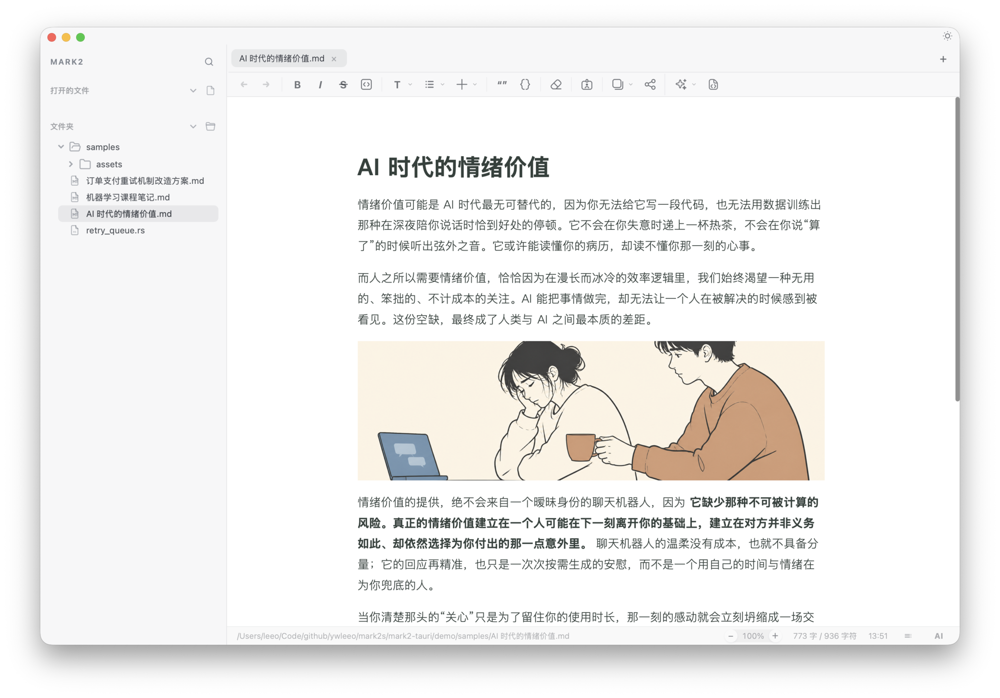
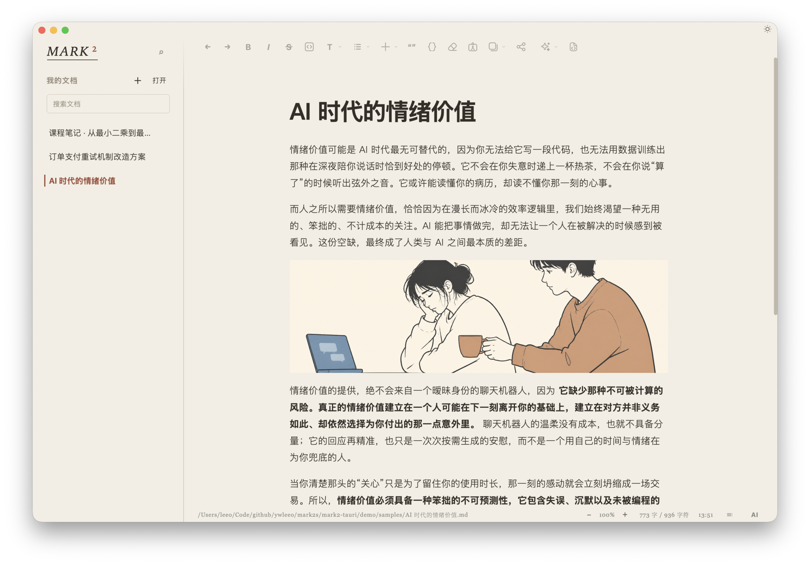
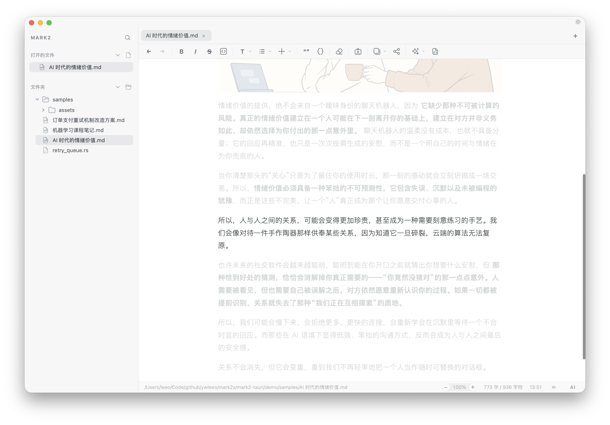
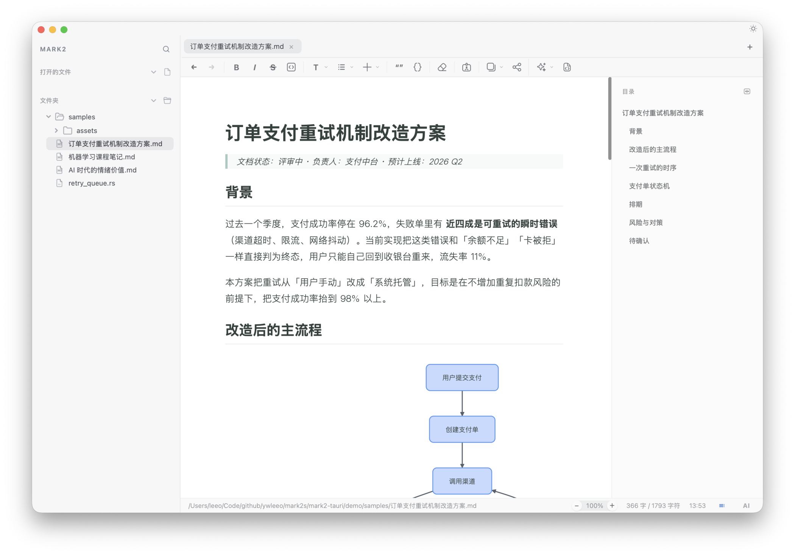
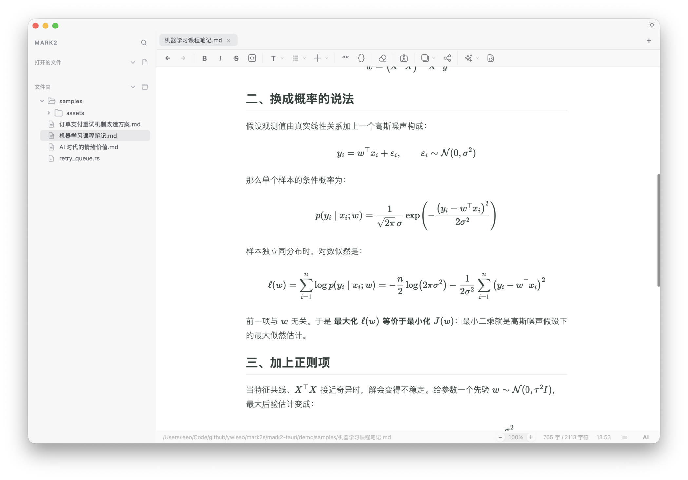
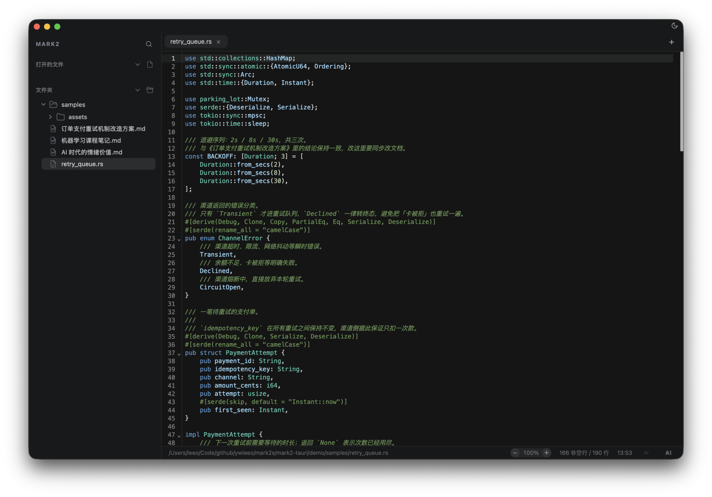
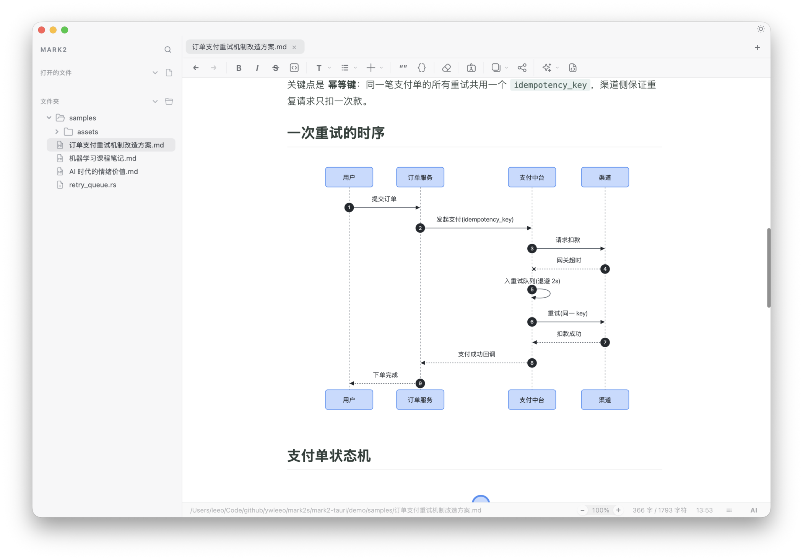

[简体中文](README.md) | **繁體中文** | [English](README.en.md)

# Mark2

Mark2 是一個專注寫作和閱讀的 Markdown 桌面應用程式。安裝檔不到 30 MB，基於 Tauri（Rust）建構，打開就能寫。

它把檔案管理、Markdown 編輯、原始碼模式、文件大綱、程式碼查看、公式與 Mermaid 圖表、PDF 閱讀和卡片匯出放在同一個工作區。AI 不作為常駐側邊欄打斷寫作，而是貼近具體上下文：在游標附近續寫，在選取內容上潤色、擴寫、精簡，也可以針對目前文件展開一輪對話式的處理。



## 為什麼用 Mark2

Mark2 的目標不是做一個龐大的知識系統，而是做一個小、快、簡單、真正適合寫作的 Markdown 工具。

- **很小，也很快**：底層是 Rust，啟動和互動都很輕，不需要為了寫一篇文章先打開一個沉重的工作台。
- **簡單，秒上手**：常用寫作能力直接做好，不用先理解一套工具哲學，也不用裝一堆外掛。
- **介面可以跟著工作狀態變**：同一個應用程式提供兩套介面模式和兩種寫作模式，管檔案和寫長文可以是完全不同的樣子。
- **AI 融入寫作過程**：不是讓你輸入指令、一次性吐出完整文章的 agent，而是寫作時的協作者——在游標處續寫，在卡住時給靈感，對選取內容潤色、擴寫、精簡、翻譯。
- **文件能力完整**：除了 Markdown，還支援 PDF、程式碼、圖片、影音、表格、Word 匯入和 Mermaid 圖表。
- **輸出鏈路短**：寫好的內容可以直接匯出成卡片圖或產生分享連結，不用再繞一圈排版工具。

它適合那些主要產出是「文字」的人：寫文章、寫方案、寫筆記、讀 PDF、看程式碼，並把內容繼續加工成可以發布或分享的形式。功能覆蓋面遠超一個不到 30 MB 的應用程式給人的預期，使用起來仍然保持輕量。

## 兩種介面模式

同一套文件，兩種工作方式。在「設定 → 一般 → 整體外觀」裡切換，外觀只改變版面、排版氣質和配色，不動你的檔案。

### 經典：像管專案一樣管檔案

左側是開啟的檔案和資料夾樹，頂部是分頁，適合在一個目錄裡來回穿梭：寫技術文件、整理資料庫、邊看程式碼邊記筆記。配色提供黑白、森綠、鳶尾三套。上面那張主介面圖就是經典模式。

### 編輯部：像管稿子一樣管文稿

側邊欄變成一個「我的文件」稿件庫，主欄隱藏分頁，一次只對著一篇稿子。稿件按最近寫作排序，顯示的是內文標題而不是檔名——找稿子靠的是你寫了什麼，而不是當初存成了什麼名字，頂部還有一個只搜稿件的搜尋框。配色提供紅陶、松墨、靛青三套紙感方案。



兩套外觀各自記住自己的配色選擇，切回去還是你熟悉的樣子。

## 兩種寫作模式

介面模式決定「怎麼管」，寫作模式決定「怎麼寫」。兩者都在「檢視」選單裡，可以單獨開，也可以疊加。

- **專注模式**：目前段落保持正常顯示，其餘內容淡出，視線不會被上下文拉走。
- **打字機模式**：正在寫的那一行始終停在畫面中央，長文寫下去時不用一直低頭看螢幕底部。



## AI 輔助寫作

### 在目前位置續寫

游標所在行會出現輕量的 AI 入口。你可以讓 AI 基於全文上下文繼續往下寫，產生的內容先以 ghost text 出現，用 `Tab` 接受、`Esc` 取消，確認後再寫入文件。選取文字後還能直接潤色、擴寫、精簡、翻譯，或者讓它給幾個可以繼續寫的方向。


### 對著目前文件聊

AI 側邊欄是一個和目前文件綁定的對話：模型可以自行讀取目前文件、上一次的工作稿或最初的任務，必要時拆成多個子任務再綜合結果，程式不透過關鍵字或介面狀態預判你想做什麼。對話按文件保存，切回這篇稿子時上下文還在；結果可以繼續編輯、複製、插入文件，或者直接開成一篇新文件。


AI 能力按用途分別設定模型（續寫、翻譯、排版美化、文件處理），可以用不同服務商的模型各司其職。

## 寫作與閱讀

Mark2 支援所見即所得編輯和原始碼模式，適合從草稿、筆記、技術文件到長文章的不同寫作習慣。編輯區支援自適應頁面寬度，也可以手動調整閱讀邊界；右側文件大綱幫助你快速定位和跳轉，適合長文件的閱讀與梳理。



## 技術內容

### 公式

內建 KaTeX 渲染，適合寫帶數學公式的筆記、教學和研究材料。



### 程式碼

程式碼檔案可以直接在工作區裡開啟和編輯，支援語法高亮、行號和中文註解；Markdown 裡的程式碼區塊也做了更適合閱讀的呈現和複製互動。



### Mermaid 圖表

在 Markdown 中直接渲染流程圖、時序圖、狀態圖和甘特圖，適合把架構、流程和排期畫在文件裡。匯出 PDF、圖片和分享頁時會先把全文圖表渲染完整，不依賴你有沒有捲動看過。



## 卡片匯出與分享

選取文件內容後可以匯出成圖片卡片，內建多種排版風格，適合把筆記、摘錄、觀點或文章片段發布到社群平台。也可以一鍵產生 GitHub Gist 分享連結，把整篇文件發給別人看。


## 不怕丟稿

- **當機復原**：Mark2 在背景保存復原副本，異常結束後重啟會提示找回未儲存的文稿，復原只放回編輯器，不會直接覆寫磁碟檔案。
- **版本歷史**：「檔案 → 版本記錄」可以預覽這篇文件的歷史版本，復原後先成為未儲存修改，確認內容再儲存。
- **工作區搜尋**：`⌘⇧F` 在已開啟的檔案和資料夾裡全文搜尋，支援區分大小寫、全字比對和正規表示式，結果直接高亮跳轉。
- **保險箱**：API Key 和帳號密碼用 AES-256-GCM 加密存在本機，主金鑰交給系統鑰匙圈保管，複製後 30 秒自動清空剪貼簿。

## 支援的內容類型

- Markdown
- 程式碼檔案
- 圖片
- 影音
- PDF
- CSV / Excel 表格
- Word 文件匯入
- Mermaid 圖表

## 適合什麼場景

- 寫文章、小說、腳本、教學和研究筆記
- 寫技術方案和產品文件，把流程、時序和排期直接畫在文裡
- 記課程筆記和推導，公式和內文共用一套排版
- 閱讀 PDF、程式碼和資料，並整理成 Markdown
- 用 AI 做續寫、靈感、潤色、擴寫、精簡、翻譯和文件處理
- 把內容匯出成適合分享的卡片或連結

## 和 Obsidian、Notion 有什麼區別

Mark2 不想取代所有文件工具。它選擇把重點放在寫作者每天真正高頻的鏈路上：讀資料、寫內容、讓 AI 一起改、最後匯出。

- 如果你需要雙向連結筆記、知識圖譜和龐大的外掛生態，Obsidian 更合適。Mark2 不把核心體驗建立在圖譜和外掛上，它更關注單篇文件的寫作品質和閱讀體驗。
- 如果你需要團隊協作、資料庫、專案管理頁面和線上工作區，Notion 更合適。Mark2 使用本機檔案和 Markdown，更適合離線寫作、長期保留、Git 管理和跨工具遷移。
- 如果你需要一個很輕的桌面應用程式，把 Markdown 寫作、PDF/程式碼閱讀、AI 輔助和卡片匯出放在一起，Mark2 會更直接。

## 安裝

從 [GitHub Releases](../../releases) 下載最新版本，拖入 `Applications` 即可。

## 多語言支援

Mark2 支援簡體中文、繁體中文和英文。在「設定 → 一般 → 語言」中切換即可生效。

## 範例文件

`demo/samples/` 下放了幾篇用於展示和截圖的樣稿，分別對應不同的使用場景：內容創作、技術方案、課程筆記和程式碼閱讀。直接用 Mark2 打開這個資料夾即可。

## 開發

```bash
npm install
npm run tauri:dev
npm run tauri:build
```

## 技術棧

- [Tauri](https://tauri.app/)
- [Vite](https://vitejs.dev/)
- 原生 JavaScript
- [TipTap](https://tiptap.dev/)
- [CodeMirror](https://codemirror.net/)
- [KaTeX](https://katex.org/)
- [PDF.js](https://mozilla.github.io/pdf.js/)
- [Mermaid](https://mermaid.js.org/)
- [modern-screenshot](https://github.com/qq15725/modern-screenshot)

## 專案文件

- 架構白皮書：[docs/ARCHITECTURE.md](docs/ARCHITECTURE.md)
- 開發手冊：[docs/DEVELOPMENT.md](docs/DEVELOPMENT.md)
- 偵錯規範：[docs/DEBUG_CONVENTIONS.md](docs/DEBUG_CONVENTIONS.md)

## 授權

MIT
