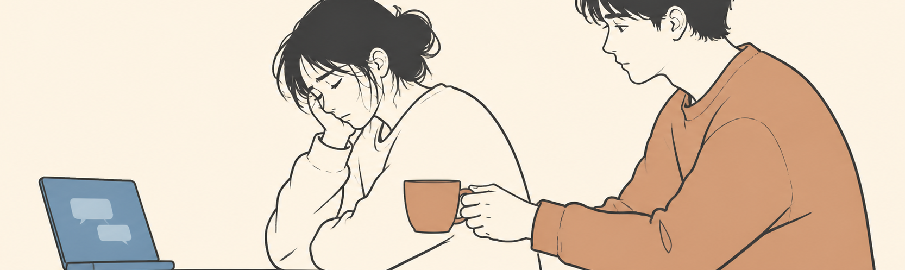

# AI 时代的情绪价值

情绪价值可能是 AI 时代最无可替代的，因为你无法给它写一段代码，也无法用数据训练出那种在深夜陪你说话时恰到好处的停顿。它不会在你失意时递上一杯热茶，不会在你说“算了”的时候听出弦外之音。它或许能读懂你的病历，却读不懂你那一刻的心事。

而人之所以需要情绪价值，恰恰因为在漫长而冰冷的效率逻辑里，我们始终渴望一种无用的、笨拙的、不计成本的关注。AI 能把事情做完，却无法让一个人在被解决的时候感到被看见。这份空缺，最终成了人类与 AI 之间最本质的差距。

情绪价值的提供，绝不会来自一个暧昧身份的聊天机器人，因为 **它缺少那种不可被计算的风险。真正的情绪价值建立在一个人可能在下一刻离开你的基础上，建立在对方并非义务如此、却依然选择为你付出的那一点意外里。** 聊天机器人的温柔没有成本，也就不具备分量；它的回应再精准，也只是一次次按需生成的安慰，而不是一个用自己的时间与情绪在为你兜底的人。

当你清楚那头的“关心”只是为了留住你的使用时长，那一刻的感动就会立刻坍缩成一场交易。所以，**情绪价值必须具备一种笨拙的不可预测性，它包含失误、沉默以及未被编程的犹豫**，而正是这些不完美，让一个“人”真正成为那个让你愿意交付心事的人。

所以，人与人之间的关系，可能会变得更加珍贵，甚至成为一种需要刻意练习的手艺。我们会像对待一件手作陶器那样供奉某些关系，因为知道它一旦碎裂，云端的算法无法复原。

也许未来的社交软件会越来越聪明，聪明到能在你开口之前就猜出你想要什么安慰，但 **那种恰到好处的猜测，恰恰会消解掉你真正需要的——“你竟然没猜对”的那一点点意外。人需要被看见，但也需要自己被误解之后，对方依然愿意重新认识你的过程。如果一切都被提前识别，关系就失去了那种“我们正在互相摸索”的质地。**

所以，我们可能会慢下来，会拒绝更多、更快的连接，会重新学会在沉默里等待一个不合时宜的回应。而那些在 AI 语境下显得低效、笨拙的沟通方式，反而会成为人与人之间最后的安全感。

关系不会消失，但它会变重，重到我们不再轻率地把一个人当作随时可替换的对话框。

