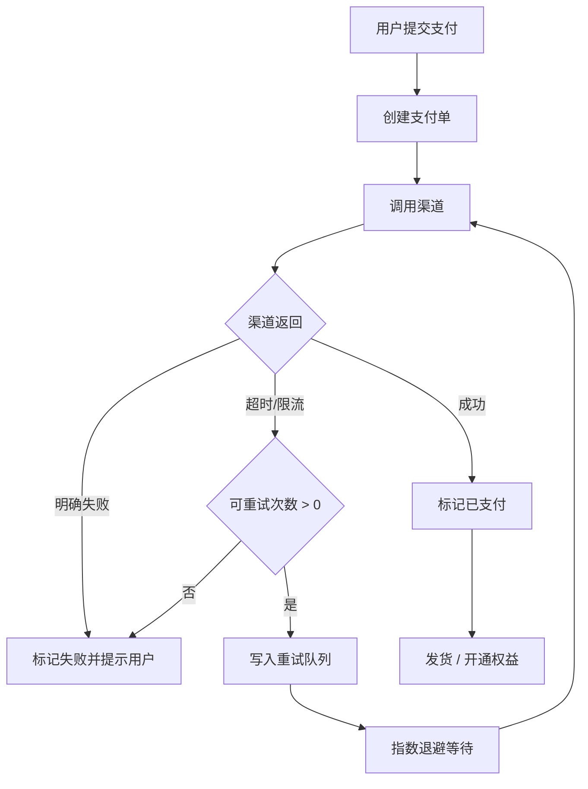
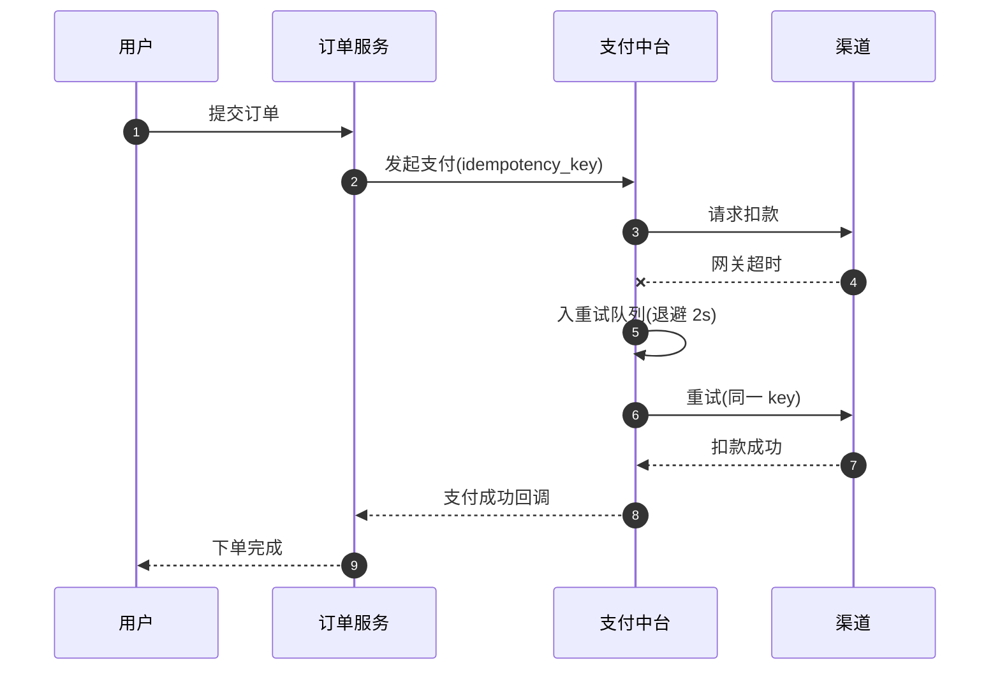
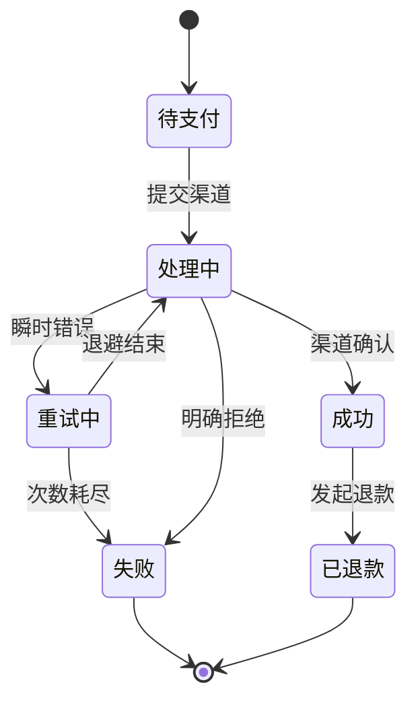
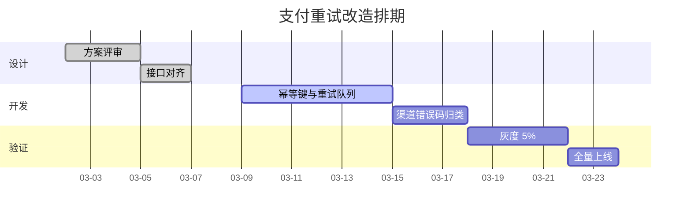

# 订单支付重试机制改造方案

> 文档状态：评审中 · 负责人：支付中台 · 预计上线：2026 Q2

## 背景

过去一个季度，支付成功率停在 96.2%，失败单里有 **近四成是可重试的瞬时错误**（渠道超时、限流、网络抖动）。当前实现把这类错误和「余额不足」「卡被拒」一样直接判为终态，用户只能自己回到收银台重来，流失率 11%。

本方案把重试从「用户手动」改成「系统托管」，目标是在不增加重复扣款风险的前提下，把支付成功率抬到 98% 以上。

## 改造后的主流程

关键点是 **幂等键**：同一笔支付单的所有重试共用一个 `idempotency_key`，渠道侧保证重复请求只扣一次款。

## 一次重试的时序

## 支付单状态机

## 排期

## 风险与对策

| 风险 | 影响 | 对策 |
| --- | --- | --- |
| 渠道幂等实现不一致 | 重复扣款 | 上线前逐渠道做幂等压测，不达标的渠道关闭重试 |
| 重试放大故障 | 渠道被打挂 | 退避 + 全局限流，渠道熔断时直接转终态 |
| 用户侧状态滞后 | 以为没付成功 | 收银台显示「处理中」，并在 30s 内推送结果 |

## 待确认

- [ ] 风控是否需要对重试单独计数
- [x] 退避策略定为 2s / 8s / 30s，共三次
- [ ] 对账口径是否按首次请求时间归集
