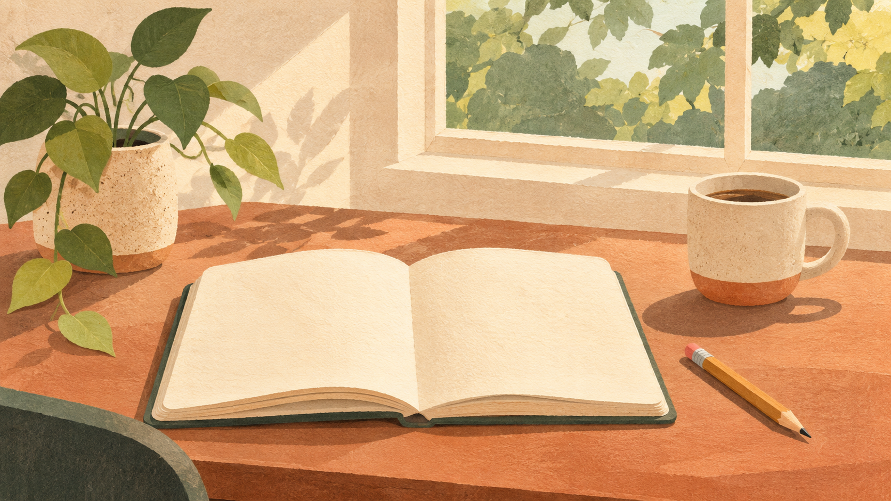

# A little room to think

A good first draft starts with a little space: one idea, a quiet page, and enough time to follow a thought before judging it.

## Begin with something worth saying

The blank page is easier when it has a question. What did you learn this week? Which small frustration keeps showing up? What would you explain to a friend over coffee?

Write the answer in ordinary language. You can give it a better shape later.

> A useful draft does not need to sound impressive. It needs to make one thing clearer.

## Separate discovery from editing

On the first pass, collect observations. On the second, look for the thread that connects them. On the third, remove anything that makes the reader work harder than necessary.

- Start with a concrete moment.
- Give each paragraph one job.
- Keep the details that help someone understand.
- Leave the reader with a next step.

## Keep your voice

A writing assistant can offer alternatives, shorten a tangled sentence, or help you find the next question. The decision about what you mean remains yours.

Clarity is not a lack of personality. It is what gives your personality room to come through.

## Make something you can share

An essay might become a newsletter. A paragraph might become an image card. A working note might become the explanation your teammate needed.

The point is not to produce more text. It is to turn a thought into something another person can use.
