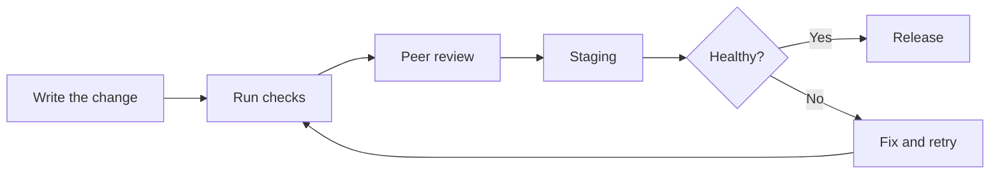

# A calmer release process

A small team should be able to ship a small change without turning the afternoon into an incident.

## The change we want

Keep builds reproducible, make the release checklist visible, and give every deployment a clear way back.

| Stage | Owner | Done when |
| --- | --- | --- |
| Prepare | Author | Changes and tests are ready |
| Review | Teammate | Behavior and risks are understood |
| Deploy | Release owner | Health checks pass |
| Observe | Team | Errors and latency remain stable |

## A simple path from draft to release

## Three useful guardrails

1. Build once and promote the same artifact.
2. Record the version, commit, and release owner.
3. Test the rollback before it is needed.

## What success looks like

A teammate can answer three questions without reading the implementation: what changed, how we checked it, and how to recover if something goes wrong.

### Before pressing release

- [x] Critical paths checked
- [x] Migration is reversible
- [x] Release notes written
- [ ] Production health verified
