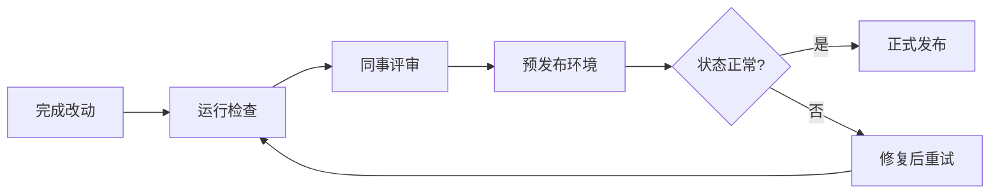

# 从容一点的发布流程

一个小团队，应该能够发布一次小改动，而不必把整个下午变成一次事故处理。

## 我们希望发生的改变

让构建可复现，让发布清单看得见，让每次部署都有明确的退路。

| 阶段 | 负责人 | 完成条件 |
| --- | --- | --- |
| 准备 | 作者 | 改动与测试就绪 |
| 评审 | 同事 | 理解行为与风险 |
| 部署 | 发布人 | 健康检查通过 |
| 观察 | 团队 | 错误与延迟保持稳定 |

## 从草稿到发布的一条短路

## 三条有用的护栏

1. 只构建一次，逐级提升同一份产物。
2. 记录版本、提交和发布负责人。
3. 在需要回滚之前，先验证回滚方案。

## 怎样才算做好

不读实现代码，同事也能回答：这次改了什么，怎样验证的，出问题如何恢复。

- [x] 关键路径已检查
- [x] 数据迁移可回退
- [x] 更新说明已完成
- [ ] 生产健康检查通过
